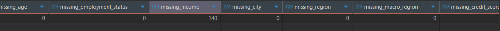
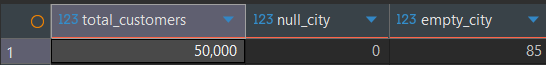
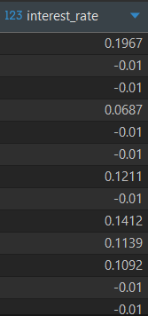
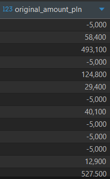
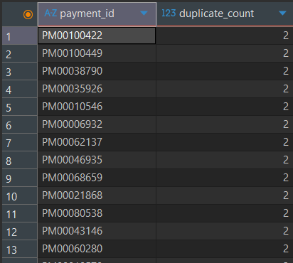
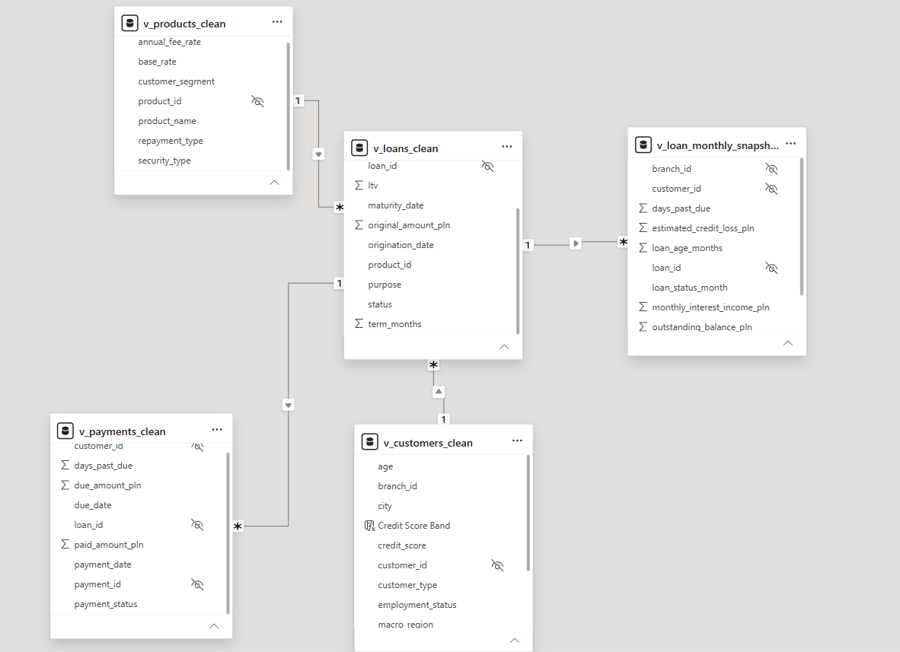
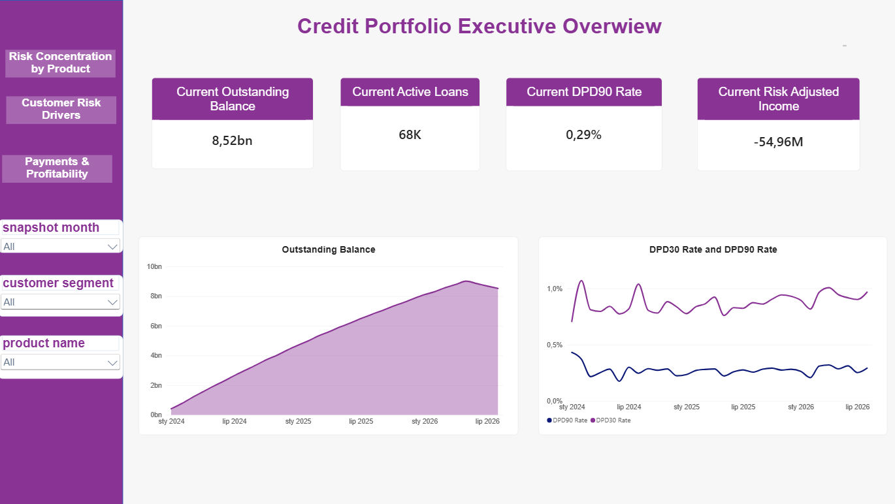
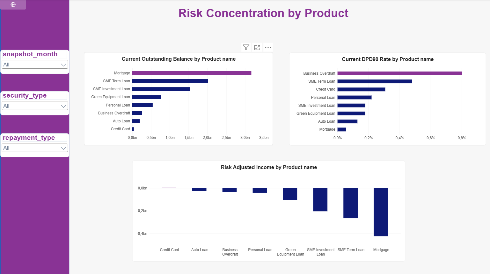
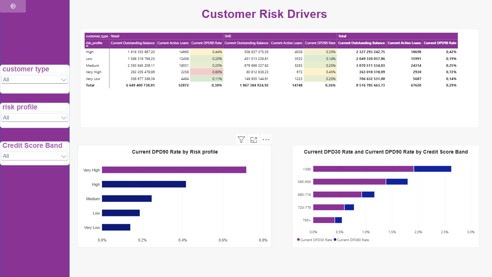
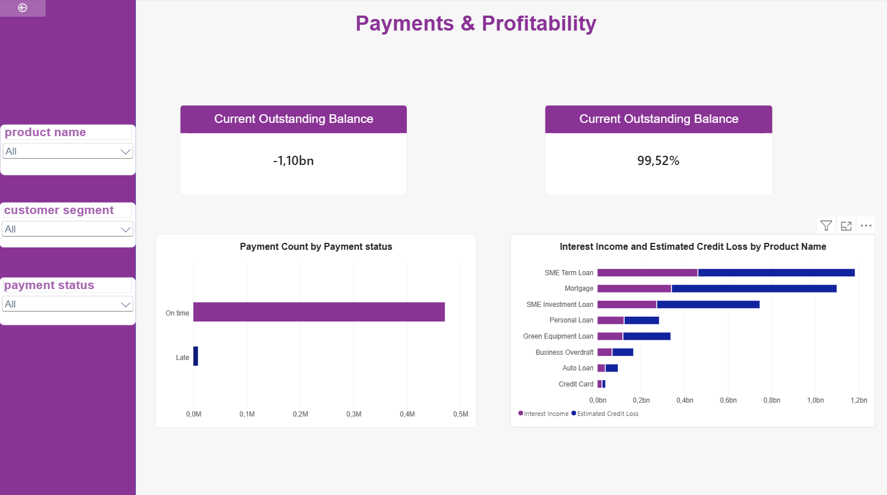

# Banking Credit Risk Analytics


<a id="project-overview"></a>
## 🏦 Project overview

This project analyzes the loan portfolio of **NovaBank**, a simulated bank operating in the Polish retail banking market and serving small and medium-sized enterprises (SMEs).

The dataset contains information about customers, loans, monthly loan performance, payment history, and lending products. The analysis follows a realistic banking workflow: data quality checks and preparation with SQL, followed by business analysis and an interactive report in Power BI.

The main areas of analysis are portfolio size and composition, delinquency trends, credit risk by product and customer segment, payment behavior, and risk-adjusted profitability.


## Table of contents

- [Business objective](#business-objective)
- [Tools](#tools)
- [Data structure](#data-structure)
- [Data quality and preparation](#data-quality-and-preparation)
  - [Customers](#customers)
  - [Loans](#loans)
  - [Payments](#payments)
  - [Monthly loan snapshots](#monthly-loan-snapshots)
  - [Products and relationships](#products-and-relationships)
- [Data model](#data-model)
- [DAX analysis](#dax-analysis)
- [Report structure and findings](#report-structure-and-findings)
- [Business recommendations](#business-recommendations)
- [Further analysis](#further-analysis)
- [Summary](#summary)


<a id="business-objective"></a>
## 🎯 Business objective

The primary objective is to assess the quality and risk profile of NovaBank's loan portfolio and identify the areas contributing most to its deterioration.

The analysis addresses the following business questions:

- How does the value of the loan portfolio change over time?
- Is the share of loans at least 30 or 90 days past due (DPD) increasing?
- Which lending products carry the highest risk?
- How does credit risk differ between Retail and SME customers?
- Are secured loans less risky than unsecured loans?
- How does the repayment type (for example, Installment or Revolving) affect portfolio risk?
- Which customer risk profiles and credit score bands are associated with higher delinquency?
- How effectively do customers repay their obligations?
- Is higher credit risk offset by sufficient interest income?
- Which products generate the highest risk-adjusted income?

The goal is to provide a clear view of portfolio performance and help management identify segments that may require closer monitoring or changes to credit policy.

<a id="tools"></a>
## 🛠️ Tools

- **SQL (PostgreSQL-compatible syntax)** — used to profile source tables, validate data, check relationships, and create cleaned views for analysis.
- **Microsoft Power BI Desktop** — used to build the relational model and interactive report, including visuals, filters, tooltips, and drillthrough pages.
- **DAX** — used to define the portfolio, delinquency, income, loss, and payment measures displayed in the report.

<a id="data-structure"></a>
## 🗂️ Data structure

The analysis is based on five related tables:

| Table | Description | Records |
|---|---|---:|
| `customers` | Customer information, including customer segment, age, employment status, monthly income, location, credit score, and risk profile. | 50,000 |
| `loans` | Loan agreements, including loan amount, interest rate, term, origination and maturity dates, LTV, purpose, and loan status. | 72,000 |
| `loan_monthly_snapshot` | Monthly records for each loan, including outstanding balance, days past due, monthly loan status, interest income, and estimated credit loss. | 1,265,930 |
| `payments` | Payment history, including due date, payment date, amount due, amount paid, payment status, and days past due. | 480,300 |
| `products` | Lending product reference data, including product name, customer segment, security type, repayment type, base rate, and annual fee rate. | 8 |
| **Total** |  | **1,868,238** |

The primary analytical table is `loan_monthly_snapshot`, where each row represents the status of a specific loan in a given month.

This structure supports time-based portfolio analysis and the calculation of key metrics such as:

- Outstanding Balance
- Active Loans
- DPD30+ Rate
- DPD90+ Rate
- Interest Income
- Estimated Credit Loss
- Risk Adjusted Income
- Collection Ratio

<a id="data-quality-and-preparation"></a>
## 🧹 Data quality and preparation

Before analyzing the loan portfolio, data quality was checked across all five core tables:

- `customers`
- `loans`
- `loan_monthly_snapshot`
- `payments`
- `products`

The checks covered missing values, duplicates, invalid numeric values, logical inconsistencies, date validity, consistency of text categories, referential integrity, and relationships between customers, loans, payments, and products.

The complete set of SQL checks is available in [`NOVABANK_data_analysis.sql`](NOVABANK_data_analysis.sql).

After the checks, five cleaned SQL views were created for analysis. The source tables were left unchanged to preserve the original data and allow comparison with the cleaned data.

<a id="customers"></a>
### 👤 Customers

The `customers` table was checked for missing values, duplicate customer IDs, valid ages, income and credit score ranges, and consistent categories such as `customer_type`, `employment_status`, and `risk_profile`. The main issues were missing `monthly_income_pln` and `city` values.

#### Missing `monthly_income_pln`

Income was missing for **140 customers**:

```sql
SELECT
    COUNT(*) AS total_customers,
    COUNT(*) FILTER (
        WHERE monthly_income_pln IS NULL
    ) AS missing_income
FROM customers;
```



Missing income was not replaced with the mean or median because there was not enough information to reliably infer a customer's actual income. Values were left as `NULL`, preserving the customer records without introducing estimates that could distort risk analysis or segmentation.

**Potential improvement:** Require income validation in the source system for products where income is necessary to assess creditworthiness.

#### Missing city

City information was missing in **85 records**. These values were stored as empty strings rather than `NULL`.

```sql
SELECT
    COUNT(*) AS total_customers,
    COUNT(*) FILTER (
        WHERE city IS NULL
    ) AS null_city,
    COUNT(*) FILTER (
        WHERE city = ''
    ) AS empty_city
FROM customers;
```



Empty values were replaced with `Unknown`. Customers were not removed because a missing location does not make a customer record invalid. This approach preserves the records without assigning an artificial location.

**Potential improvement:** Validate the city during customer registration or require address selection from a controlled list of locations.

#### Business-range validation

The following customer attributes were checked for plausible values:

```sql
SELECT *
FROM customers
WHERE age < 18
   OR age > 100
   OR credit_score < 300
   OR credit_score > 850
   OR monthly_income_pln < 0;
```

The project applies these validation rules: age must be between 18 and 100; `credit_score` must be between 300 and 850; and monthly income may be unknown (`NULL`), but must not be negative when present.

The cleaned view applies those rules and normalizes blank city values:

```sql
CREATE OR REPLACE VIEW v_customers_clean AS
SELECT
    customer_id,
    customer_type,
    age,
    employment_status,
    monthly_income_pln,
    COALESCE(
        NULLIF(TRIM(city), ''),
        'Unknown'
    )::varchar AS city,
    region,
    macro_region,
    credit_score,
    relationship_start_date,
    branch_id,
    risk_profile
FROM customers
WHERE age BETWEEN 18 AND 100
  AND credit_score BETWEEN 300 AND 850
  AND (
      monthly_income_pln IS NULL
      OR monthly_income_pln >= 0
  );
```

All **50,000 customers** remained in the cleaned view.

<a id="loans"></a>
### 💳 Loans

The `loans` table was checked for missing values, unique `loan_id` values, valid loan amounts and interest rates, loan terms, valid dates, and links to customers and products.

The main issues were **45 loans with invalid interest rates** and **35 loans with invalid original amounts**.

#### Invalid interest rates

The `interest_rate` was less than or equal to zero in 45 records:

```sql
SELECT *
FROM loans
WHERE interest_rate <= 0;
```



These values were considered invalid for the portfolio. They were not replaced with an average rate or a product rate because the correct value for an individual loan could not be determined. The affected loans were excluded from `v_loans_clean`, avoiding fabricated rates that could distort interest income and portfolio profitability.

**Potential improvement:** Validate interest rates when loan agreements are entered and reject values less than or equal to zero.

#### Invalid `original_amount_pln`

In **35 records**, `original_amount_pln <= 0`:

```sql
SELECT *
FROM loans
WHERE original_amount_pln <= 0;
```



A zero or negative original loan amount does not represent a valid loan agreement. These records were not automatically corrected because the correct amount could not be reliably reconstructed. They were excluded from `v_loans_clean`.

**Potential improvement:** Add a source-system constraint that prevents saving a loan with an amount less than or equal to zero.

#### Loan consistency and cleaned view

Additional checks covered the loan term and date order:

```sql
SELECT *
FROM loans
WHERE term_months <= 0
   OR maturity_date < origination_date;
```

The term must be greater than zero, and the maturity date must not precede the origination date. The cleaned view also ensures each loan is linked to a valid customer and product:

```sql
CREATE OR REPLACE VIEW v_loans_clean AS
SELECT
    l.loan_id,
    l.customer_id,
    l.product_id,
    l.branch_id,
    l.origination_date,
    l.maturity_date,
    l.original_amount_pln,
    l.interest_rate,
    l.term_months,
    l.ltv,
    l.purpose,
    l.status
FROM loans l
INNER JOIN v_customers_clean c
    ON l.customer_id = c.customer_id
INNER JOIN v_products_clean p
    ON l.product_id = p.product_id
WHERE l.original_amount_pln > 0
  AND l.interest_rate > 0
  AND l.term_months > 0
  AND l.maturity_date >= l.origination_date;
```

The number of loans decreased from **72,000 to 71,920**; **80 records** were excluded.

#### Missing LTV

Missing `ltv` values occurred only for `Unsecured` products, while `Secured` loans had an LTV value. Missing LTV was therefore treated as logically not applicable rather than as a data quality issue. Values were left unchanged.

**Potential improvement:** Document in the data model that `NULL` LTV means “not applicable” for unsecured products.

<a id="payments"></a>
### 💰 Payments

The `payments` table was checked for missing values, duplicate `payment_id` values and full-row duplicates, negative amounts and DPD values, valid dates, and relationships to loans and customers. The main issue was **300 duplicated payment records**.

#### Duplicate payment IDs

Duplicates were identified with:

```sql
SELECT
    payment_id,
    COUNT(*) AS duplicate_count
FROM payments
GROUP BY payment_id
HAVING COUNT(*) > 1
ORDER BY duplicate_count DESC;
```



Keeping duplicate records could inflate total payments and payment counts, distort the Collection Ratio, and lead to an incorrect assessment of customer payment behavior.

#### Checking full-row duplicates

Since a repeated ID does not always mean that every field is duplicated, all record values were compared before removing duplicates:

```sql
SELECT
    payment_id,
    loan_id,
    customer_id,
    due_date,
    payment_date,
    due_amount_pln,
    paid_amount_pln,
    days_past_due,
    payment_status,
    COUNT(*) AS duplicate_count
FROM payments
GROUP BY
    payment_id,
    loan_id,
    customer_id,
    due_date,
    payment_date,
    due_amount_pln,
    paid_amount_pln,
    days_past_due,
    payment_status
HAVING COUNT(*) > 1
ORDER BY duplicate_count DESC;
```

#### Removing duplicates

Only the first record for each `payment_id` was retained. The view also filters invalid amounts and DPD values and excludes payments associated with loans removed from `v_loans_clean`:

```sql
CREATE OR REPLACE VIEW v_payments_clean AS
WITH ranked_payments AS (
    SELECT
        p.payment_id,
        p.loan_id,
        p.customer_id,
        p.due_date,
        p.payment_date,
        p.due_amount_pln,
        p.paid_amount_pln,
        p.days_past_due,
        p.payment_status,
        ROW_NUMBER() OVER (
            PARTITION BY p.payment_id
            ORDER BY
                p.payment_date,
                p.loan_id,
                p.customer_id
        ) AS rn
    FROM payments p
)
SELECT
    rp.payment_id,
    rp.loan_id,
    rp.customer_id,
    rp.due_date,
    rp.payment_date,
    rp.due_amount_pln,
    rp.paid_amount_pln,
    rp.days_past_due,
    rp.payment_status
FROM ranked_payments rp
INNER JOIN v_loans_clean l
    ON rp.loan_id = l.loan_id
WHERE rp.rn = 1
  AND rp.due_amount_pln >= 0
  AND rp.paid_amount_pln >= 0
  AND rp.days_past_due >= 0;
```

The record count decreased from **480,300 to 479,486**; **814 records** were excluded. This is more than the number of duplicates alone because some payments were associated with loans excluded from `v_loans_clean`.

**Potential improvement:** Use a unique payment transaction ID and enforce its uniqueness in the source system.

<a id="monthly-loan-snapshots"></a>
### 📅 Monthly loan snapshots

The `loan_monthly_snapshot` table was checked for duplicate loan-month observations and invalid `loan_age_months`, `outstanding_balance_pln`, `days_past_due`, `monthly_interest_income_pln`, and `estimated_credit_loss_pln` values.

#### Duplicate loan-month observations

Each loan should have no more than one record for a given month:

```sql
SELECT
    loan_id,
    snapshot_month,
    COUNT(*) AS duplicate_count
FROM loan_monthly_snapshot
GROUP BY
    loan_id,
    snapshot_month
HAVING COUNT(*) > 1
ORDER BY duplicate_count DESC;
```

Duplicates could cause outstanding balances, interest income, and active loan counts to be double-counted.

#### Invalid snapshot values

The following checks identify implausible negative values:

```sql
SELECT *
FROM loan_monthly_snapshot
WHERE loan_age_months < 0
   OR outstanding_balance_pln < 0
   OR days_past_due < 0
   OR monthly_interest_income_pln < 0
   OR estimated_credit_loss_pln < 0;
```

Negative `monthly_interest_income_pln` values were traced to loans with invalid negative `interest_rate`. The issue originated in `loans`, rather than being an independent snapshot data issue. Instead of filtering negative income directly in the snapshot table, the invalid loans were excluded at the source:

```sql
CREATE OR REPLACE VIEW v_loan_monthly_snapshot_clean AS
SELECT
    s.snapshot_month,
    s.loan_id,
    s.customer_id,
    s.product_id,
    s.branch_id,
    s.loan_age_months,
    s.outstanding_balance_pln,
    s.days_past_due,
    s.loan_status_month,
    s.monthly_interest_income_pln,
    s.estimated_credit_loss_pln
FROM loan_monthly_snapshot s
INNER JOIN v_loans_clean l
    ON s.loan_id = l.loan_id
WHERE s.loan_age_months >= 0
  AND s.outstanding_balance_pln >= 0
  AND s.days_past_due >= 0
  AND s.estimated_credit_loss_pln >= 0;
```

This removes the cause of the issue and prevents invalid data from propagating into KPIs. The record count decreased from **1,265,930 to 1,264,613**; **1,317 snapshots** were excluded.

**Potential improvement:** Validate loan interest rates before generating monthly snapshots so that invalid rates cannot affect later interest income.

<a id="products-and-relationships"></a>
### 📦 Products and relationships

The `products` table serves as the product dimension. Checks covered missing values, duplicate `product_id` values, product names, `customer_segment`, `security_type`, `repayment_type`, `base_rate`, `annual_fee_rate`, and consistency of text categories.

```sql
SELECT DISTINCT customer_segment
FROM products
ORDER BY customer_segment;

SELECT DISTINCT security_type
FROM products
ORDER BY security_type;

SELECT DISTINCT repayment_type
FROM products
ORDER BY repayment_type;
```

Negative rate values were checked separately:

```sql
SELECT *
FROM products
WHERE base_rate < 0
   OR annual_fee_rate < 0;
```

No significant issues requiring correction were identified. A cleaned view was still created so that Power BI uses validated SQL views rather than the source table directly:

```sql
CREATE OR REPLACE VIEW v_products_clean AS
SELECT
    product_id,
    product_name,
    customer_segment,
    security_type,
    repayment_type,
    base_rate,
    annual_fee_rate
FROM products
WHERE product_id IS NOT NULL
  AND product_name IS NOT NULL
  AND customer_segment IS NOT NULL
  AND security_type IS NOT NULL
  AND repayment_type IS NOT NULL
  AND base_rate >= 0
  AND annual_fee_rate >= 0;
```

All **8 products** remained in the table.

**Potential improvement:** Restrict categorical fields to a controlled vocabulary in the source system.

Relationships between tables and the resulting views were also validated. For example, the following query checks whether each payment refers to an existing loan:

```sql
SELECT
    p.*
FROM payments p
LEFT JOIN loans l
    ON p.loan_id = l.loan_id
WHERE l.loan_id IS NULL;
```

Equivalent checks covered:

- `loans → customers`
- `loans → products`
- `payments → loans`
- `payments → customers`
- `loan_monthly_snapshot → loans`

<a id="data-model"></a>
## 🔗 Data model

After data preparation, the tables were organized into a relational Power BI model centered on `v_loans_clean`, which connects customer and product details with monthly loan snapshots and payment history.

Most relationships follow a one-to-many structure:

| From | Cardinality | To | Filter direction | Status |
|---|---|---|---|---|
| `v_loan_monthly_snapshot_clean[loan_id]` | `*:1` | `v_loans_clean[loan_id]` | `v_loans_clean → v_loan_monthly_snapshot_clean` | Active |
| `v_loans_clean[customer_id]` | `*:1` | `v_customers_clean[customer_id]` | `v_customers_clean → v_loans_clean` | Active |
| `v_loans_clean[product_id]` | `*:1` | `v_products_clean[product_id]` | `v_products_clean → v_loans_clean` | Active |
| `v_payments_clean[loan_id]` | `*:1` | `v_loans_clean[loan_id]` | `v_loans_clean → v_payments_clean` | Active |

`v_customers_clean` contains one record per customer. A customer may have multiple loans, so the relationship to `v_loans_clean` is `1:*`. This allows filters such as customer type, risk profile, credit score, and location to affect the analysis of their loans.

`v_products_clean` is the product dimension. A product may appear in many loan agreements, enabling portfolio analysis by product name, customer segment, security type, and repayment type.

`v_loans_clean` is the central table. Each loan is associated with one customer and one product, and may be linked to multiple payments and monthly observations. It connects descriptive data with transactional and monthly data.

`v_loan_monthly_snapshot_clean` stores each loan's monthly status, including outstanding balance, Days Past Due, monthly interest income, and Estimated Credit Loss. A loan may have one observation for each month.

`v_payments_clean` contains payment history. A loan may have multiple payments, so this table also has a `1:*` relationship to `v_loans_clean`. It is primarily used to analyze payment behavior and Collection Ratio.

All relationships are active and use single-direction filtering from the `1` side to the `*` side. A filter on a customer or product flows through `v_loans_clean` to the related monthly snapshots and payments.

This model supports analysis across customers, products, loans, performance over time, and payment history.



<a id="dax-analysis"></a>
## 📈 DAX analysis

After building the data model, DAX measures were created to turn loan, monthly portfolio, and payment data into indicators for credit risk and profitability analysis.

The main analytical areas include portfolio value, active loans, DPD30+ and DPD90+ delinquency, interest income, Estimated Credit Loss, Risk Adjusted Income, the latest portfolio position, and payment effectiveness.

### Portfolio balance

```DAX
Outstanding Balance =
SUM(
    v_loan_monthly_snapshot_clean[outstanding_balance_pln]
)
```

Calculates the total outstanding balance in the current filter context. It is used to analyze portfolio size and changes over time.

### Delinquency rates

```DAX
DPD30 Rate =
DIVIDE(
    [DPD30 Loans],
    [Active Loans],
    0
)
```

Calculates the share of active loans at least 30 days past due and helps identify early deterioration in portfolio quality.

```DAX
DPD90 Rate =
DIVIDE(
    [DPD90 Loans],
    [Active Loans],
    0
)
```

Calculates the share of loans at least 90 days past due. This is a key risk measure for comparing portfolio quality across products, customer segments, and risk profiles.

### Income and risk-adjusted income

```DAX
Interest Income =
SUM(
    v_loan_monthly_snapshot_clean[monthly_interest_income_pln]
)
```

Calculates total interest income generated by the portfolio in the current context.

```DAX
Estimated Credit Loss =
SUM(
    v_loan_monthly_snapshot_clean[estimated_credit_loss_pln]
)
```

Calculates total estimated credit losses and is used to assess the impact of credit risk on portfolio performance.

```DAX
Risk Adjusted Income =
[Interest Income] - [Estimated Credit Loss]
```

Calculates the difference between interest income and estimated credit loss. In this project, it is a simplified risk-adjusted income measure used to assess whether portfolio income offsets expected credit losses.

### Latest portfolio position

The report also uses the latest snapshot date to calculate current portfolio KPIs:

```DAX
Current Outstanding Balance =
VAR LatestDate = [Latest Snapshot Date]
RETURN
CALCULATE(
    [Outstanding Balance],
    v_loan_monthly_snapshot_clean[snapshot_month] = LatestDate
)
```

```DAX
Current Active Loans =
VAR LatestDate = [Latest Snapshot Date]
RETURN
CALCULATE(
    [Active Loans],
    v_loan_monthly_snapshot_clean[snapshot_month] = LatestDate
)
```

```DAX
Current DPD90 Rate =
VAR LatestDate = [Latest Snapshot Date]
RETURN
CALCULATE(
    [DPD90 Rate],
    v_loan_monthly_snapshot_clean[snapshot_month] = LatestDate
)
```

These measures return the balance, number of active loans, and DPD90 Rate for the latest available month. They are used in KPI cards and cross-sectional analyses.

### Payments

```DAX
Collection Ratio =
DIVIDE(
    [Total Paid Amount],
    [Total Due Amount],
    0
)
```

Calculates the amount paid divided by the amount due, showing payment effectiveness for the selected portfolio.

```DAX
Payment Count =
COUNTROWS(v_payments_clean)
```

Counts payment records and supports comparisons by payment status, such as `On time` and `Late`.

The complete DAX measure reference is available in [`NovaBank_DAX_Measures.txt`](NovaBank_DAX_Measures.txt).

<a id="report-structure-and-findings"></a>
## 📊 Report structure and findings

The Power BI report contains **6 pages**: four pages that form the main analytical narrative, plus Tooltip and Drillthrough pages for deeper exploration. The sequence moves from the overall portfolio view to product and customer risk, payment behavior, and risk-adjusted performance.

### 1. Credit Portfolio Executive Overview 🏠

This page answers: **What is the overall condition of the loan portfolio, and how has it changed over time?**

It presents the latest portfolio KPIs:

- **Current Outstanding Balance**
- **Current Active Loans**
- **Current DPD90 Rate**
- **Current Risk Adjusted Income**

Two time-series charts show Outstanding Balance and DPD30 Rate/DPD90 Rate. Filters are available for `snapshot_month`, `customer_segment`, and `product_name`.



#### Key findings 💡

The current portfolio is worth approximately **PLN 8.52 billion**, with around **67,600 active loans**. It grew rapidly from less than **PLN 1 billion in early 2024** to around **PLN 9 billion in 2026**, followed by a small decline.

Despite this growth, DPD90 Rate remained relatively stable at around **0.2–0.3%**, while DPD30 Rate was mostly around **0.8–1.0%**. Portfolio growth did not result in a proportional increase in severe delinquency.

However, **Current Risk Adjusted Income is approximately -PLN 54.96 million**. Stable DPD90 does not necessarily mean that portfolio performance is positive after Estimated Credit Loss is taken into account.

### 2. Risk Concentration by Product 💳

This page shifts the focus from the overall portfolio to individual products and asks: **Which products have the largest exposure and the highest risk?**

It compares Current Outstanding Balance by Product, Current DPD90 Rate by Product, and Risk Adjusted Income by Product. Filters are available for `snapshot_month`, `security_type`, and `repayment_type`.



#### Key findings 💡

**Mortgage** has the largest exposure, with a balance of approximately **PLN 3.2 billion**, or **37–38%** of the current portfolio. The next largest products are **SME Term Loan** at around **PLN 2.0 billion** and **SME Investment Loan** at around **PLN 1.5–1.6 billion**. Together, these products represent most of the portfolio exposure.

The highest **Current DPD90 Rate** is observed for **Business Overdraft**, at around **0.8%**, despite its relatively small exposure. **SME Term Loan** also has an elevated DPD90 Rate of approximately **0.5%**. Mortgage, despite having the largest balance, has one of the lowest DPD90 rates.

This shows that exposure size and risk intensity are different:

- Mortgage primarily contributes concentration risk because of its scale.
- Business Overdraft has the highest intensity of delinquency.

Mortgage also has the largest negative Risk Adjusted Income, followed by SME Term Loan and SME Investment Loan. A product with relatively low DPD90 can still materially affect portfolio results if its exposure is very large.

### 3. Customer Risk Drivers 👥

This page asks: **Which customer characteristics are associated with higher credit risk?**

A matrix compares Retail and SME customers by risk profile using Current Outstanding Balance, Current Active Loans, and Current DPD90 Rate. Additional charts show Current DPD90 Rate by `risk_profile` and Current DPD30 Rate/Current DPD90 Rate by Credit Score Band. Filters include `customer_type`, `risk_profile`, and Credit Score Band.



#### Key findings 💡

Retail accounts for approximately **PLN 6.65 billion**, or **78%** of the current portfolio balance; SME accounts for around **PLN 1.87 billion**. Current DPD90 Rate is approximately **0.30% for Retail** and **0.26% for SME**, a relatively small difference.

Differences between risk profiles are more pronounced. Current DPD90 Rate is:

- **Very High:** 0.72%
- **High:** 0.42%
- **Medium:** 0.25%
- **Low:** 0.19%
- **Very Low:** 0.14%

Severe delinquency increases with the customer risk profile. However, the **Medium** risk group has the largest exposure, at approximately **PLN 3.07 billion**. The highest delinquency is not necessarily found in the segment with the largest portfolio balance.

Credit Score Band shows a similar pattern: both DPD30 Rate and DPD90 Rate decrease as credit scores increase. Delinquency is highest in the **<580** band and lowest in the **780+** band. Both Risk Profile and Credit Score distinguish customers by credit risk.

### 4. Payments & Profitability 💰

This page connects customer payment behavior with portfolio financial performance and asks: **Does effective repayment also result in positive performance after credit risk is considered?**

It includes Risk Adjusted Income, Collection Ratio, Payment Count, Interest Income, and Estimated Credit Loss. Filters are available for `product_name`, `customer_segment`, and `payment_status`.



#### Key findings 💡

**Collection Ratio is 99.52%**, and most payments have the `On time` status, indicating very high current payment effectiveness.

At the same time, Risk Adjusted Income for the analyzed period is approximately **-PLN 1.10 billion**. Under the definition used in this project, Estimated Credit Loss exceeds generated interest income.

Estimated Credit Loss is higher than Interest Income for the major products, particularly:

- SME Term Loan
- Mortgage
- SME Investment Loan

The key takeaway is that **high payment effectiveness does not automatically mean positive risk-adjusted performance**. A portfolio can have an excellent Collection Ratio and still generate negative Risk Adjusted Income if expected credit losses are high.

### 5. Product summary Tooltip 💬

The report includes a hidden **Tooltip** page that provides context without requiring the user to leave the current chart. Hovering over a product displays:

- **Current Outstanding Balance**
- **Current DPD90 Rate**
- **Estimated Credit Loss**
- **Risk Adjusted Income**
- **Collection Ratio**

This enables quick comparisons of exposure, risk, and product performance.

### 6. Product detail Drillthrough 🔎

The report also includes a **Drillthrough** page based on `product_name`. It allows users to move from product-level analysis to a detailed view of a selected product.

The table includes `product_name`, `risk_profile`, Current Outstanding Balance, Current Active Loans, Current DPD30 Rate, Current DPD90 Rate, Estimated Credit Loss, Risk Adjusted Income, and Collection Ratio. This makes it possible to identify which risk profiles within a product account for the greatest exposure and delinquency.

<a id="business-recommendations"></a>
## ✅ Business recommendations

The analysis highlights several areas that merit attention:

- **Monitor Business Overdraft more closely** because it has the highest DPD90 Rate. Review credit limits, customer profiles, and exposure renewal rules.
- **Monitor SME Term Loan for both risk and exposure.** It combines a relatively large portfolio balance with one of the highest DPD90 rates.
- **Manage concentration risk in Mortgage.** Despite its low DPD90, it represents the largest share of the portfolio, so even a small deterioration could materially affect the bank.
- **Continue using Risk Profile and Credit Score as key monitoring dimensions.** Both clearly distinguish delinquency levels and can inform monitoring intensity.
- **Review Very High risk customers and customers with low credit scores in more detail.** Consider additional limits, more frequent monitoring, or more conservative lending rules.
- **Assess Collection Ratio alongside Estimated Credit Loss.** Strong current payment performance does not automatically mean positive risk-adjusted returns.
- **Assess product profitability using both exposure size and risk.** DPD alone is not sufficient to evaluate a product's economics.

<a id="further-analysis"></a>
## 🚀 Further analysis

Potential next steps include:

- **DPD migration analysis:** Track how loans move between `Current`, DPD30+, DPD60+, and DPD90+ and identify which customer groups deteriorate most often.
- **Vintage analysis:** Compare loans by origination month or year to determine whether newer cohorts perform better or worse than earlier ones.
- **Roll-rate analysis:** Measure the probability of a loan moving from one delinquency category to the next.
- **Secured vs. unsecured product comparison:** Test whether collateral is associated with lower DPD and Estimated Credit Loss.
- **Expanded profitability analysis:** The current Risk Adjusted Income is a simplified measure based on Interest Income and Estimated Credit Loss. A more advanced analysis could include funding and operating costs, fees, and cost of capital.
- **Predictive risk model:** Use Credit Score, Risk Profile, product type, DPD history, income, and other features to predict the probability of a customer reaching DPD90+.
- **Early warning system:** Automatically flag customers for additional monitoring when DPD or other indicators deteriorate over successive months.

<a id="summary"></a>
## 📝 Summary

This project demonstrates an end-to-end loan portfolio analysis workflow: data quality checks and preparation of consistent SQL views, a relational Power BI model, and a report that guides users from an overall portfolio view to more detailed analysis of products, customers, payments, and risk.

The analysis uses five core tables covering customers, loans, monthly loan snapshots, payments, and products. Source tables were preserved after data quality checks, while cleaned SQL views were used for analysis. This made it possible to remove duplicates, exclude invalid loans, retain logically missing values, and maintain consistent relationships between tables.

The Power BI report contains four main analytical pages, plus Tooltip and Drillthrough pages. It moves from overall portfolio performance through product and customer risk concentration to payment behavior and risk-adjusted results.

NovaBank's portfolio is worth approximately **PLN 8.52 billion** and contains around **67,600 active loans**. It grew rapidly during the analyzed period, while DPD90 Rate remained relatively stable at approximately **0.29%**.

Risk is not evenly distributed. Mortgage accounts for the largest share of exposure, while Business Overdraft has the highest DPD90 Rate. Customer analysis also shows clear relationships between delinquency, risk profile, and Credit Score Band: higher-risk customers and those with lower scores are more likely to be past due.

Collection Ratio is **99.52%**, indicating highly effective current repayments. Nevertheless, Risk Adjusted Income remains negative. Under the definition used in this project, interest income does not fully offset Estimated Credit Loss.

The main conclusion is that stable delinquency and high repayment effectiveness do not automatically imply low risk or positive risk-adjusted performance. Portfolio assessment requires simultaneous consideration of exposure size, customer quality, DPD levels, and the effect of expected credit losses.
